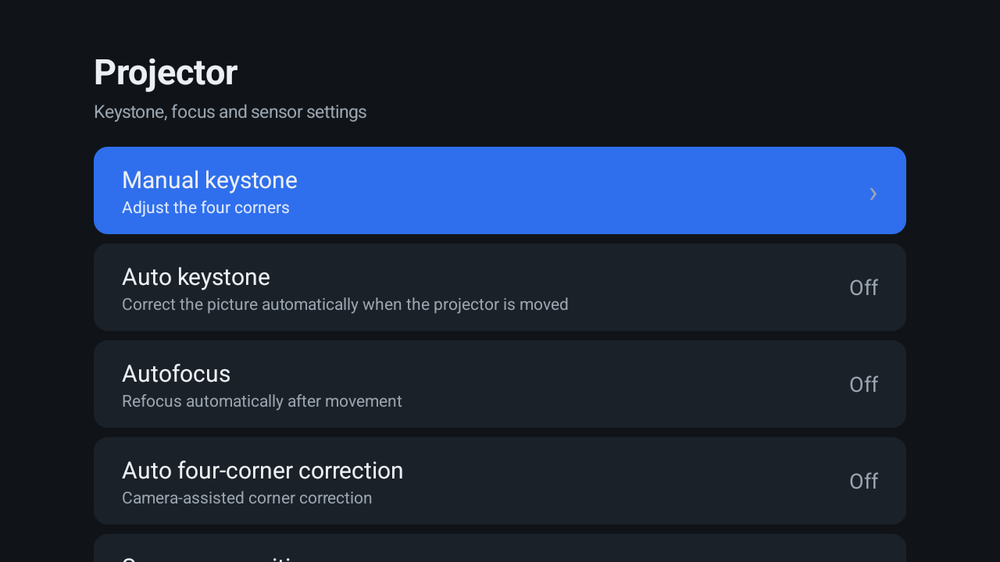
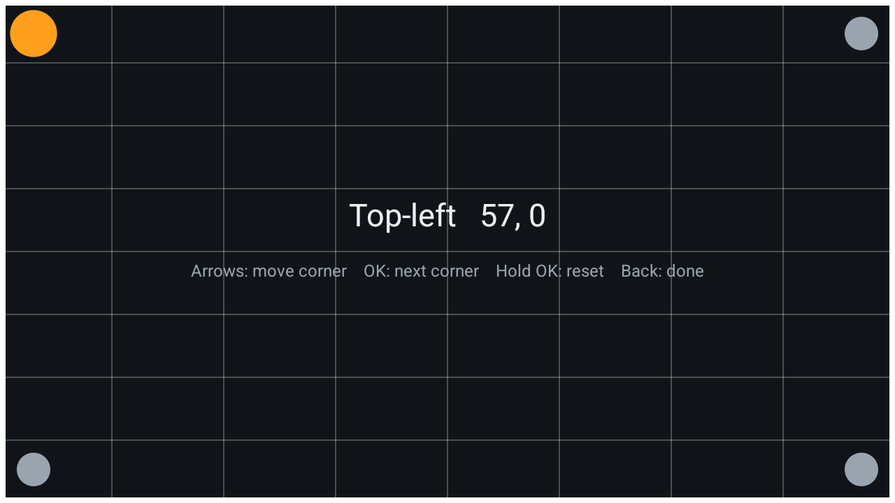

# hy300-projector-settings

A small, clean replacement for the keystone / focus settings of the **Magcubic HY300 Pro**
projector (Allwinner H726, Android 14), so you can run any launcher you like.

On this projector the 4-corner keystone screen and the projection toggles live inside the
stock launcher, `com.htc.magcubicos`. That launcher ships with Baidu telemetry and
vendor app-store hooks, so it is worth disabling. But disabling it also takes away manual
keystone. This app brings those settings back as a normal launcher tile.




## Features

- **Manual keystone**: full-screen 4-corner editor driven by the remote
  (arrows move the selected corner, OK switches to the next corner, hold OK resets, Back
  saves and exits). Changes apply live and survive a reboot.
- **Toggles**: auto keystone, autofocus, auto four-corner correction, screen recognition,
  obstacle avoidance, anti-shake.
- **Focus calibration**: opens the vendor calibration screen (`com.hysd.vafocus/.VajzActivity`).
- **Reset keystone**.
- No network permission, no dependencies. About 30 KB.

## Install

Download `Projector.apk` from [Releases](../../releases) and side-load it:

```sh
adb install -r Projector.apk
```

You do not need root. You can then disable the stock launcher if you use another one
(for example [CleanYourTV](https://github.com/Gathin23/cleanyourtv)):

```sh
adb shell pm disable-user --user 0 com.htc.magcubicos   # undo: pm enable com.htc.magcubicos
```

## Build

You need the Android SDK (`platforms/android-34`, `build-tools/34.0.0`) and a JDK. Gradle is
not required:

```sh
./build.sh            # → build/Projector.apk (signed with ~/.android/debug.keystore, created if missing)
```

## How it works

The stock launcher was decompiled to find out how it applies these settings:

| Setting | Mechanism |
|---|---|
| Manual keystone | HIDL `vendor.display.config@1.0::IDisplayConfig` transaction **36**: two floats (zoom h/v = 100) followed by four `{int32 x, int32 y}` corner points (TL, TR, BL, BR) in panel pixels (`persist.vendor.disp.screensize`, 1280×720 on this unit). The insets are then saved in `persist.display.keystone_{ltx,lty,rtx,rty,lbx,lby,rbx,rby}` so they are restored at boot. |
| Auto keystone | `persist.sys.tpryauto` |
| Autofocus | `persist.sys.vafocus` |
| Auto four-corner | `persist.sys.tpryxcrt` |
| Screen recognition | `persist.sys.mbrecognize` |
| Obstacle avoidance | `persist.sys.obstacle` |
| Anti-shake | `hotack.sensor.anti_shake` |

The vendor's `com.hysd.vafocus` service reads the `persist.sys.*` toggles.

A normal app cannot call `HwBinder` or `SystemProperties.set` directly, because they are hidden
APIs. To get around this, the app starts a small helper (`Helper.java`) from its own APK with
`app_process`, which runs outside the app's hidden-API restrictions. The app then talks to the
helper over stdin and stdout. This works on this firmware because SELinux is **permissive**. A
firmware with SELinux enforcing would most likely block it.

You can also use the helper by hand from `adb shell`:

```sh
adb shell 'CLASSPATH=$(pm path com.hy300.projectorsettings | cut -d: -f2) \
  app_process /system/bin com.hy300.projectorsettings.Helper'
ks 54 0 44 0 0 0 0 0      # corner insets: ltx lty rtx rty lbx lby rbx rby
get persist.sys.vafocus
set persist.sys.vafocus 1
```

## Compatibility

Tested on a HY300 Pro, firmware `Projector.20260817.160250`. Other H726 projectors built on
the same vendor display HAL (HY300 Pro+, HY350, …) will probably work too, but they are
untested.

## Related

- [hy300pro-badbox-audit](https://github.com/det-peralta/hy300pro-badbox-audit): security
  audit of this projector (BADBOX 2.0 malware, root, cleanup)

## License

MIT
